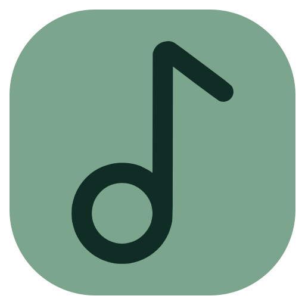

<h1> DroidMediaLink</h1>

**让电脑控制 Android 手机音乐：通过局域网同步播放状态与封面，集成 Windows SMTC、远程播放控制和桌面歌词。**

[下载 v1.2.0](https://github.com/XHZ-Steve/DroidMediaLink/releases/tag/v1.2.0) · [English](README.en.md) · [使用方法](#开始使用) · [反馈问题](https://github.com/XHZ-Steve/DroidMediaLink/issues)

音乐在手机上播放，电脑也能接上当前的歌曲、封面、进度和歌词。DroidMediaLink 通过局域网连接 Android 与 Windows，让你使用桌面播放控件、系统媒体键或悬浮播放器控制手机，耳机和音频输出仍留在手机上。

查看动态演示与 Android 界面

以上为真实设备截图与录屏，拍摄于不同时间；部分外观可能与当前版本略有差异。

## 现有功能

| | 能做什么 |
| :--- | :--- |
| **手机音乐同步** | 同步歌曲、歌手、专辑、封面、播放状态和进度；电脑控制播放、暂停、上一首、下一首、跳转及手机媒体音量。收藏仅在播放器提供接口时显示。 |
| **Windows 系统集成** | 接入 SMTC，向系统媒体面板同步歌曲与封面，响应系统媒体键；支持托盘、全局快捷键、透明悬浮播放器和置顶桌面歌词。 |
| **自动歌词** | 本地缓存优先，多来源自动匹配；支持手机公开歌词、本地导入、逐行/逐字时间轴、翻译与罗马音、跨来源翻译补全和手动版本映射。 |
| **歌词呈现** | 连续滚动、逐字高亮、长句滚动、加载淡入与布局过渡；主页和桌面歌词共用媒体时钟，各自调整排版、字体、颜色和显示策略。 |
| **高清封面** | 先显示手机原始封面，Windows 异步获取高清版本；支持 MusicBrainz / Cover Art Archive，以及实验性的网易云、QQ 音乐适配。支持来源拖动排序、获取测试、缓存和失败回退。 |
| **沉浸式外观** | 封面取色、流动环境光、可调流体补光、深浅主题和可选 Liquid Glass；胶囊进度条、水玻璃播放按钮、各布局的封面/标题/歌词定位与对齐。 |
| **设备与设置** | 局域网发现、双方核对数字后手机授权、保存配对、撤销授权与自动重连；两级设置分类、全局搜索、实时预览、预设、分组重置与配置导入导出。 |
| **应用更新** | 两端手动检查 GitHub Release，比较版本；确认后下载并校验安装包，Windows 启动安装程序，Android 调起系统安装界面。 |

Android 是被动连接服务，不周期性联网搜索封面；网络封面增强在 Windows 异步执行。窗口隐藏或拖动时减少不必要的界面刷新，连接与媒体通信独立运行。

## 下载

| 平台 | 文件 | 使用方式 |
| :--- | :--- | :--- |
| Windows x64 | [安装版 EXE](https://github.com/XHZ-Steve/DroidMediaLink/releases/download/v1.2.0/DroidMediaLink-1.2.0-windows-x64-setup.exe) | 安装后启动 |
| Windows x64 | [便携版 ZIP](https://github.com/XHZ-Steve/DroidMediaLink/releases/download/v1.2.0/DroidMediaLink-1.2.0-windows-x64.zip) | 完整解压，运行 `DroidMediaLink.exe` |
| Android 8.0+ | [APK](https://github.com/XHZ-Steve/DroidMediaLink/releases/download/v1.2.0/DroidMediaLink-1.2.0-android-test-signed.apk) | 安装后完成权限引导 |
| 校验 | [SHA256SUMS.txt](https://github.com/XHZ-Steve/DroidMediaLink/releases/download/v1.2.0/SHA256SUMS.txt) | 核对下载文件完整性 |

Windows 11 x64 是主要目标。Windows 包尚未做 Authenticode 签名；Android APK 使用开发签名。更新不会要求你卸载旧版本；Android 仍需系统安装授权及相同签名，Windows 更新安装时会退出应用。

## 开始使用

1. **安装两端应用。** 手机按首次分页引导授予通知使用权，并按需设置通知、电池和后台运行权限，开启连接服务。
2. **连接同一局域网。** 在电脑右上角隐藏式设置入口进入「设备与连接」，搜索并选择手机。
3. **确认配对。** 核对两端显示的数字，在手机点击确认。以后可自动重连，无需输入地址或证书。
4. **播放音乐。** 在手机原来的音乐 App 中播放；电脑自动显示媒体信息并匹配歌词。通过托盘或设置继续调整桌面歌词、悬浮播放器及外观。

首次启动采用维护者当前使用的默认偏好，包含通透光学材质、流体补光与歌词布局；已有用户的设置保留。默认配置不包含设备身份、地址、凭据或窗口坐标。

## 兼容性与边界

- 手机播放器需要发布 Android 标准 MediaSession。收藏、跳转、未播放时的控制和完整手机歌词取决于播放器提供的能力。
- 手机没有公开完整歌词时，可使用在线来源或本地导入。在线歌词与封面可能无结果、超时或受服务调整影响；已有封面保留，媒体控制不依赖这些查询。
- 网易云、QQ 音乐封面接口属于实验适配，不保证长期可用；第三方图片与歌词的权利属于相应权利人。详见 [封面来源与限制](docs/high-resolution-covers.md)。
- 应用不转发音频、不下载音乐、不投屏，也不提供传统本地音乐库。设备之间使用认证加密连接；不要将手机服务端口开放到公网。
- 更新必须由用户确认；下载包按 GitHub 发布的 SHA-256 校验，Android 安装仍由系统决定。网络或校验失败时不替换已安装版本；安装由系统或安装程序完成。

## 开发与文档

Windows 使用 **C++20 · Qt 6 Quick/QML · Win32/C++/WinRT**；Android 使用 **Kotlin · Jetpack Compose · Material 3**。

[构建与打包](docs/build-and-release.md) · [架构](docs/architecture.md) · [协议](protocol/README.md) · [测试记录](docs/testing.md) · [更新说明](CHANGELOG.md) · [隐私](docs/privacy.md) · [已知限制](docs/known-limitations.md)

感谢 [qwindowkit](https://github.com/stdware/qwindowkit)、[liquidglass](https://github.com/shayann07/liquidglass)、[AndroidLiquidGlass / Backdrop](https://github.com/Kyant0/AndroidLiquidGlass) 与 Lucide 等开源项目。完整依赖与授权见 [第三方声明](THIRD_PARTY_NOTICES.md)，项目许可证见 [LICENSE](LICENSE)。
